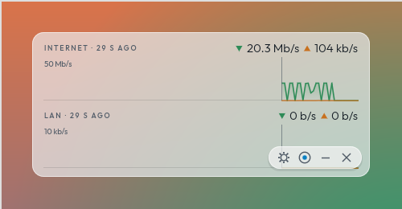
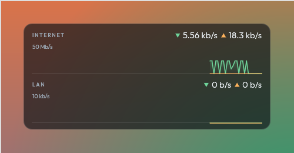
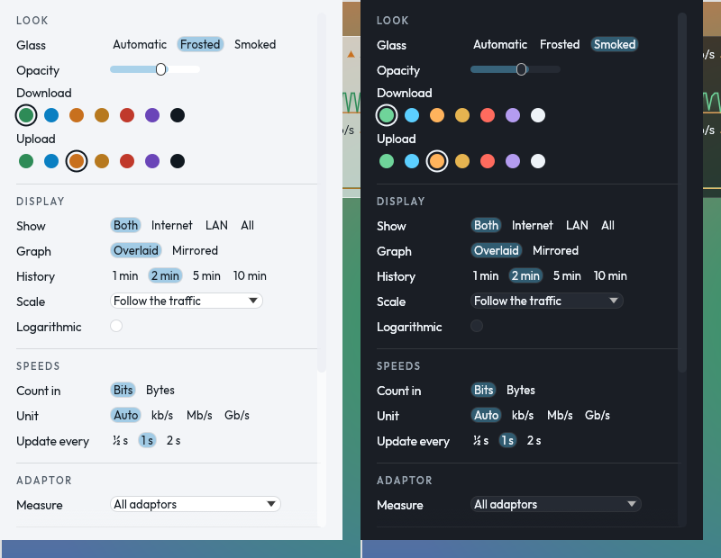

# TAW Net Meter (NM-001)

A small window that sits on the desktop and shows how fast the network is going: download and upload as scrolling graphs, like BitMeter, with the Internet and the local network (LAN) apart. It wears **Glass**, the Timster's Audio Works look for utilities and gadgets (from TAW-Panel's looks review): frosted or smoked glass with the desktop showing through, Outfit type, and the controls only under the mouse.

It only reads the computer's own counters. It never sends anything.

**Version 0.2.0.** Downloads for Linux and Windows are on the [releases page](https://github.com/TimsterAudio/NetMeter/releases): extract the archive and run `taw-netmeter` (Linux; `packaging/linux/taw-netmeter.desktop` adds it to the menu) or `taw-netmeter.exe` (Windows).





## Using it

- **The graphs**: download is the green trace with a fill fading under it, upload the orange line (Glass's OK and Pen 2 colours; both can be changed in Settings). The figures along the top are the latest reading; hover over the graph to read any moment.
- **The controls** (settings, stay on top, minimise, close) appear in a pill at the bottom right while the mouse is over the window. **H**, or a double-click, turns them off for a bare gadget. Drag anywhere to move the window; resize from any edge.
- **T** keeps it on top of other windows, or not (on by default).
- **Right-click** for the everyday choices: what to show, bits or bytes, frosted or smoked, mirrored, stay on top, Settings.
- **Settings** open in a window of their own, beside the meter: the glass (automatic, frosted or smoked; how see-through) and the download and upload colours; Internet, LAN, both or all traffic; overlaid (both up from the bottom) or mirrored (download up from the middle, upload down); 1 to 10 minutes of history; a scale that follows the traffic, a fixed top (1 Mb/s to 10 Gb/s) or a custom one (any figure in kb/s, Mb/s or Gb/s, or the byte units, such as your broadband's 300 Mb/s), linear or logarithmic; bits or bytes, the unit automatic or fixed, powers of 1000 or 1024; how often it reads (½, 1 or 2 s); which adaptor; and **Start when I log in** (an entry in `~/.config/autostart` on Linux, or in your user's Run list on Windows; the meter keeps it pointing at the copy you last ran).

The glass shows the desktop through where the system composites windows (Windows, and Linux desktops with a compositor, which is nearly all of them); elsewhere it's solid.



## Internet and LAN

The adaptors' own counters give the total. The LAN's share comes from the kernel's list of TCP connections (sock_diag, which needs no special rights): bytes to and from private addresses (10/8, 172.16/12, 192.168/16, link-local, IPv6 unique-local and the computer's own IPv6 prefixes), with the headers each segment carries added so it matches what the adaptor counts. The Internet is the rest.

What that means in practice:

- LAN traffic over **UDP** (some game streaming and casting) counts as Internet. File shares, media servers, backups and copies between computers are TCP and count as LAN.
- A connection that closes between two readings loses its last moment to the Internet figure.
- With **one adaptor** chosen, the LAN figure still covers every adaptor.
- **Windows** shows all traffic for now: Windows only keeps per-connection byte counts for administrators, so the split needs more work there (see below).

"All adaptors" means the real ones (Ethernet, Wi-Fi). Bridges, tunnels, VPNs and containers' links are left out, as their traffic is counted again on the real adaptor; pick one by name in Settings to watch it alone.

## Building

```sh
cargo build --release      # target/release/taw-netmeter
```

On Linux it needs nothing beyond what eframe needs (X11 or Wayland). Checks before pushing:

```sh
cargo fmt --check
cargo clippy --all-targets -- -D warnings
cargo test
cargo clippy --target x86_64-pc-windows-gnu --all-targets -- -D warnings   # Windows still compiles
```

## Files

| File | What it does |
|---|---|
| `src/main.rs` | The window. |
| `src/app.rs` | The display (graphs, scale, readings, hover), the controls under the mouse, the quick menu and the settings window. |
| `src/autostart.rs` | Starting when the user logs in (Linux autostart entry, Windows Run key). |
| `src/glass.rs` | The Glass look: colours, Outfit type, the traces, the control pill and its icons. |
| `src/rates.rs` | Rates, units and formatting, scales, and the history. Unit tested. |
| `src/lan.rs` | LAN or Internet, by address. Unit tested. |
| `src/sampler.rs` | Reads the counters on its own thread at the chosen interval. |
| `src/net/` | Each system's counters: Linux (`/proc/net/dev`, sock_diag), Windows (`GetIfTable2`). |
| `src/icon.rs` | The window icon. |
| `assets/fonts/` | Outfit (Light, Regular, Medium), under the SIL Open Font License (`OFL.txt`). |

## Next

- Windows: the LAN split, from TCP extended statistics when run as administrator, or ETW's network events.
- Totals for the day and the month, kept between runs.
- A place in the family switcher, if the family wants it there.
